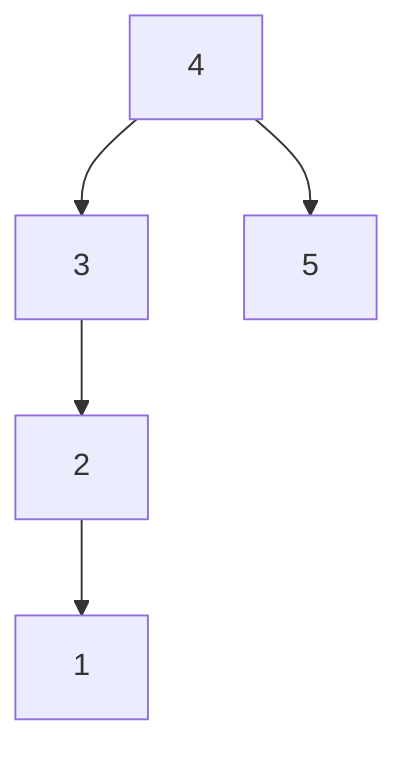
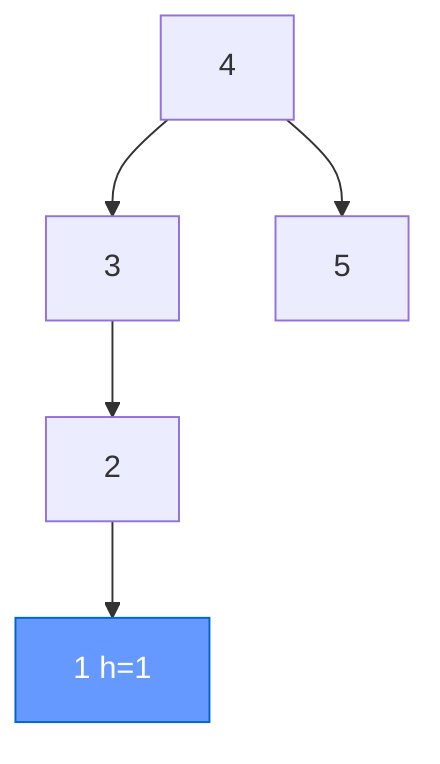
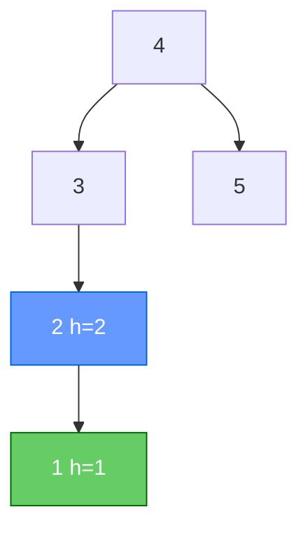
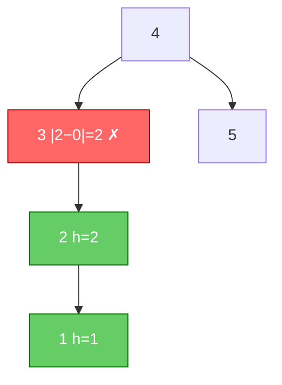
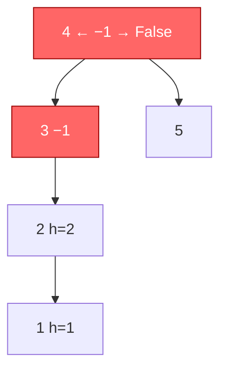
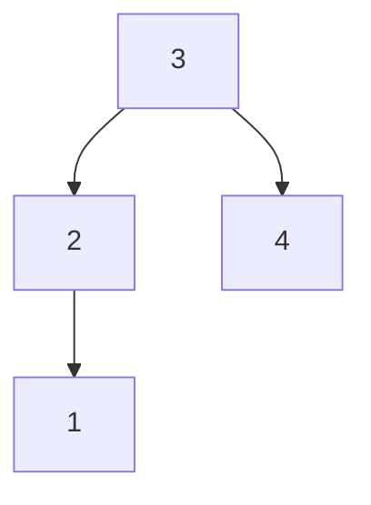
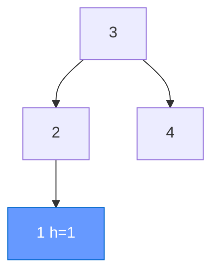
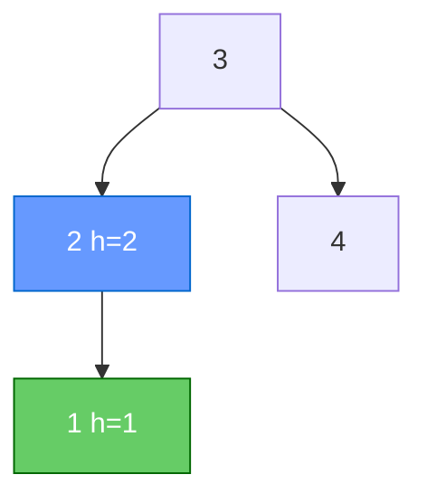
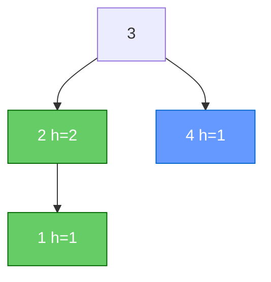
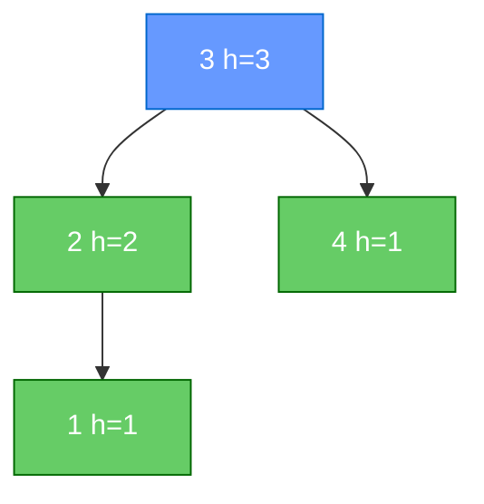

# Задача 3. Balanced Binary Tree

## Контракт

Функция `is_balanced(root) -> bool` принимает корень бинарного дерева
и возвращает `True`, если дерево **сбалансировано по высоте**:
для **каждого** узла `|height(left) − height(right)| ≤ 1`.
Иначе — `False`. Высота пустого дерева = 0.

В примерах ниже деревья также удовлетворяют свойству BST
(`left < root < right`) — для наглядности, сам алгоритм значения не использует.

## Объяснение решения

Считаем высоты снизу вверх (postorder). Для каждого узла:

1. рекурсивно получаем высоты левого и правого поддеревьев;
2. если хотя бы одно поддерево уже несбалансировано — пробрасываем сигнал;
3. если `|hl − hr| > 1` — узел несбалансирован;
4. иначе высота узла = `1 + max(hl, hr)`.

Сигнал несбалансированности кодируем как `-1`, чтобы за один обход
и посчитать высоты, и проверить условие. Как только находим нарушение —
можно не считать остальное (ранний выход вверх по стеку).

**Корректность.** Определение требует проверки у *каждого* узла.
Postorder гарантирует: когда смотрим узел, оба поддерева уже проверены
и их высоты известны. Значит условие для узла и для всех потомков
проверяется ровно один раз.

## Оценка сложности

Пусть `n` — число узлов, `h` — высота.

| | Сложность | Почему |
|---|---|---|
| **Время** | `O(n)` | каждый узел обрабатывается один раз |
| **Память** | `O(h)` | стек рекурсии; худший случай `O(n)` |

(Наивный вариант «для каждого узла отдельно считать высоты» был бы `O(n²)`.)

## Визуализация работы алгоритма

Нетривиальный пример — дисбаланс **не у корня**, а глубже.
Postorder снизу вверх. Синий — текущий узел; зелёный — высота уже
посчитана; красный — нарушение (`-1`).

Исходное дерево:

**Шаг 1.** Узел `1` (лист): left h = 0, right h = 0, `|0−0| = 0` ≤ 1  
→ h = `1 + max(0, 0) = 1`.

**Шаг 2.** Узел `2`: left = h(1) = 1, right = 0, `|1−0| = 1` ≤ 1  
→ h = `1 + max(1, 0) = 2`.

**Шаг 3.** Узел `3`: left = h(2) = 2, right = 0 (пустой), `|2−0| = 2` **> 1**  
→ возвращаем `-1` (нарушение).

**Шаг 4.** Узел `5` не считаем: слева от корня уже `-1`.

**Шаг 5.** Узел `4` получает `-1` от левого ребёнка → проброс → **False**.

У корня высоты поддеревьев могли бы отличаться ≤ 1, но узел `3`
уже ломает определение.

---

### Для сравнения — сбалансированное дерево

**Шаг 1.** Узел `1` (лист): `|0−0| = 0` → h = 1.

**Шаг 2.** Узел `2`: left = 1, right = 0, `|1−0| = 1` → h = 2.

**Шаг 3.** Узел `4` (лист): `|0−0| = 0` → h = 1.

**Шаг 4.** Узел `3`: left = 2, right = 1, `|2−1| = 1` ≤ 1  
→ h = `1 + max(2, 1) = 3` → **True**.

