# Задача 1. Tree Traversal

## Контракт

- Класс `BST` с методом `insert(val)` — вставка с сохранением свойств BST
  (строго меньшие — влево, `≥` — вправо).
- Функции обхода `preorder` / `inorder` / `postorder` /
  `reverse_preorder` / `reverse_inorder` / `reverse_postorder`:
  принимают корень `TreeNode | None`, возвращают `list` значений
  в порядке посещения.

## Объяснение решения

### Вставка в BST

Идём от корня вниз: если `val < node.val` — влево, иначе — вправо.
Когда находим пустую ссылку — создаём там новый узел.
Инвариант: для любого узла все значения в левом поддереве `< val`,
в правом — `≥ val`.

### Шесть DFS-обходов

Все обходы — рекурсивный DFS. Разница только в порядке действий
«посетить узел» / «пойти влево» / «пойти вправо»:

| Обход | Порядок |
|---|---|
| preorder | корень → левое → правое |
| inorder | левое → корень → правое |
| postorder | левое → правое → корень |
| reverse preorder | корень → правое → левое |
| reverse inorder | правое → корень → левое |
| reverse postorder | правое → левое → корень |

**Корректность.** Для BST inorder даёт неубывающую последовательность
(доказательство индукцией по дереву), preorder дает возможнотсь восстановить дерево по получившемуся массиву. Reverse-варианты — те же обходы
с обменом левого и правого ребёнка.
Для BST reverse inorder даёт невозрастающий порядок.

## Оценка сложности

Пусть `n` — число узлов, `h` — высота дерева.

| | Сложность | Почему |
|---|---|---|
| **insert** (время) | `O(h)` | спуск по одному пути, в среднем `O(log n)`, худший `O(n)` |
| **insert** (память) | `O(1)` | итеративно, без стека вызовов |
| **обход** (время) | `O(n)` | каждый узел посещается ровно один раз |
| **обход** (память) | `O(n)` | список результата `O(n)` + стек рекурсии `O(h)` |

## Визуализация работы алгоритма

Нетривиальный пример: вставка `[10, 5, 15, 3, 7, 20, 6]`.
Новый узел — зелёный; путь сравнения — синий.

### Пошаговая вставка

**Шаг 1.** `insert(10)` — дерево пустое → корень.

**Шаг 2.** `insert(5)`: `5 < 10` → влево от 10.

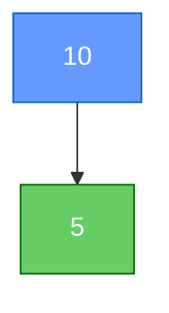

**Шаг 3.** `insert(15)`: `15 > 10` → вправо от 10.

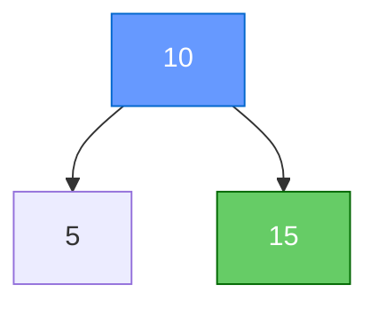

**Шаг 4.** `insert(3)`: `3 < 10` → к 5; `3 < 5` → влево от 5.

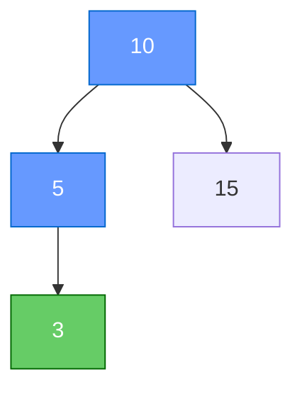

**Шаг 5.** `insert(7)`: `7 < 10` → к 5; `7 > 5` → вправо от 5.

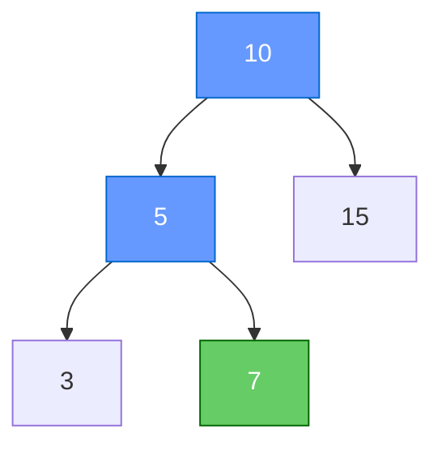

**Шаг 6.** `insert(20)`: `20 > 10` → к 15; `20 > 15` → вправо от 15.

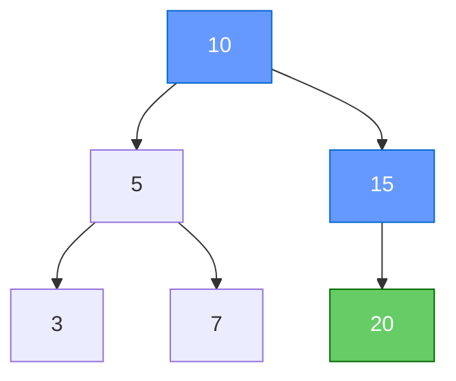

**Шаг 7.** `insert(6)`: `6 < 10` → к 5; `6 > 5` → к 7; `6 < 7` → влево от 7.

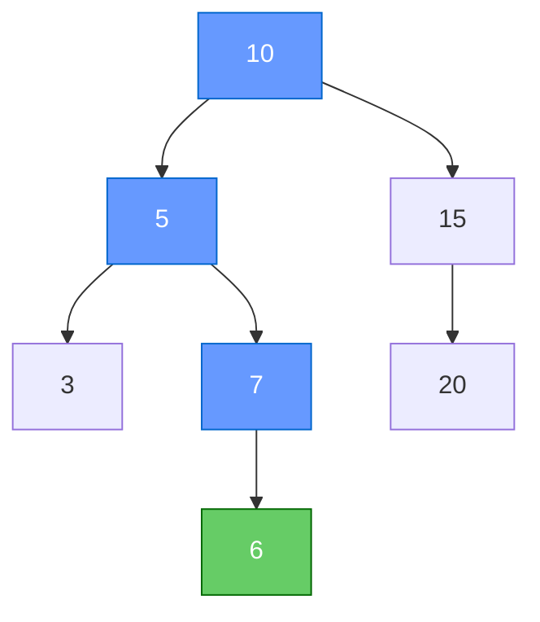

### Обходы (порядок посещения)

| Обход | Результат |
|---|---|
| preorder | `[10, 5, 3, 7, 6, 15, 20]` |
| inorder | `[3, 5, 6, 7, 10, 15, 20]` |
| postorder | `[3, 6, 7, 5, 20, 15, 10]` |
| reverse preorder | `[10, 15, 20, 5, 7, 6, 3]` |
| reverse inorder | `[20, 15, 10, 7, 6, 5, 3]` |
| reverse postorder | `[20, 15, 6, 7, 3, 5, 10]` |

### Preorder по шагам (корень → левое → правое)

Оранжевый — только что посещённый узел; серый — уже в результате.

**Шаг 1.** visit 10 → `[10]`

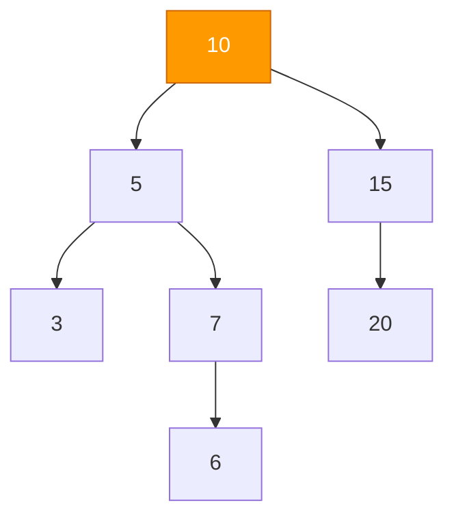

**Шаг 2.** влево → visit 5 → `[10, 5]`

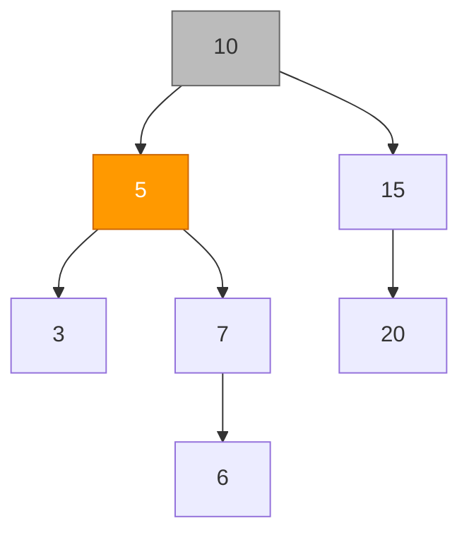

**Шаг 3.** влево → visit 3 (лист) → `[10, 5, 3]`

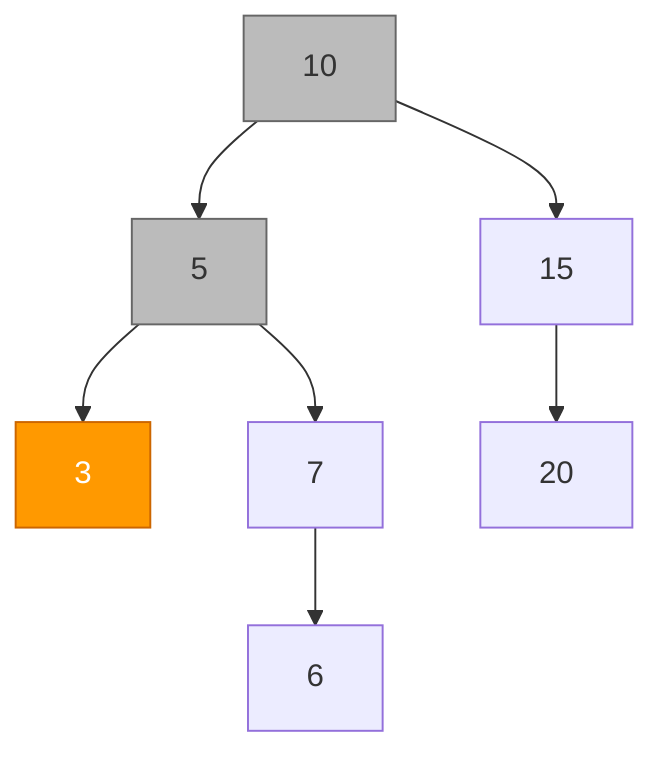

**Шаг 4.** назад к 5, вправо → visit 7 → `[10, 5, 3, 7]`

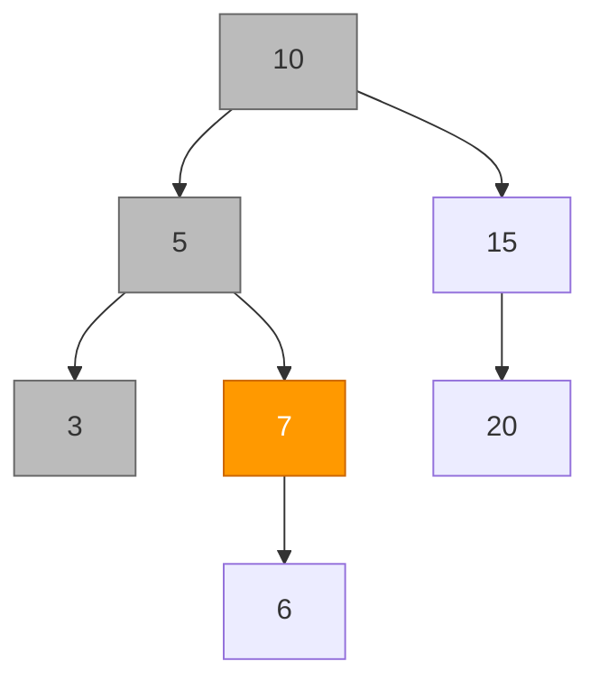

**Шаг 5.** влево → visit 6 (лист) → `[10, 5, 3, 7, 6]`

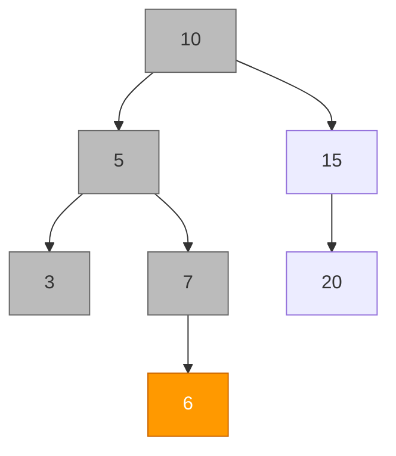

**Шаг 6.** левое поддерево 10 готово → вправо → visit 15 → `[10, 5, 3, 7, 6, 15]`

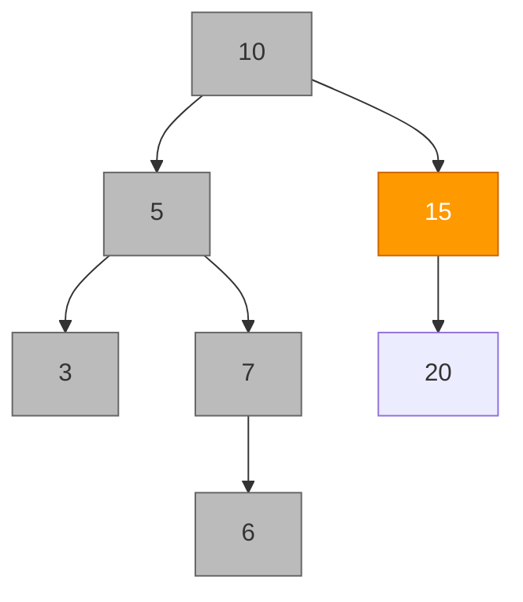

**Шаг 7.** вправо → visit 20 (лист) → `[10, 5, 3, 7, 6, 15, 20]`

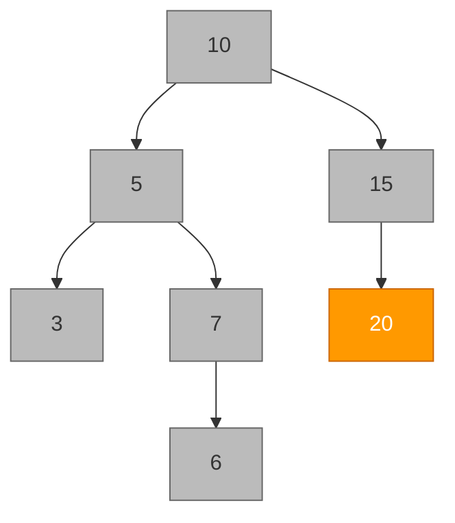
