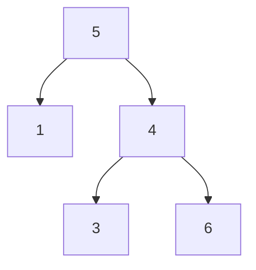
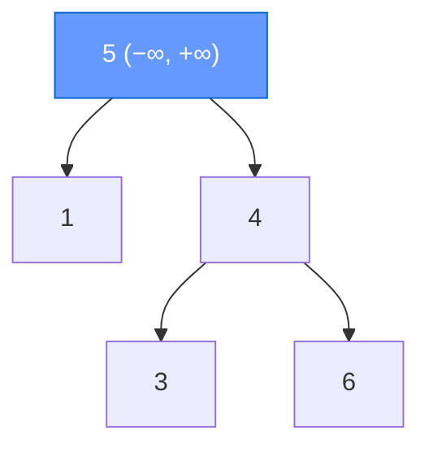
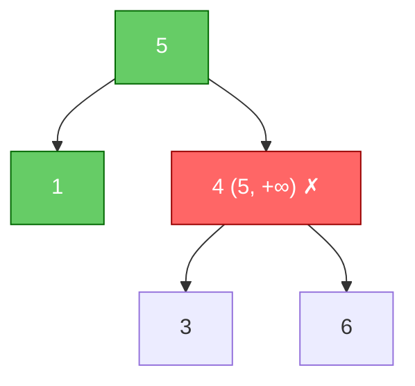
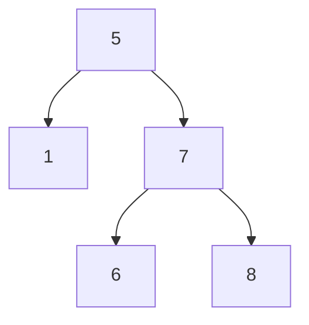
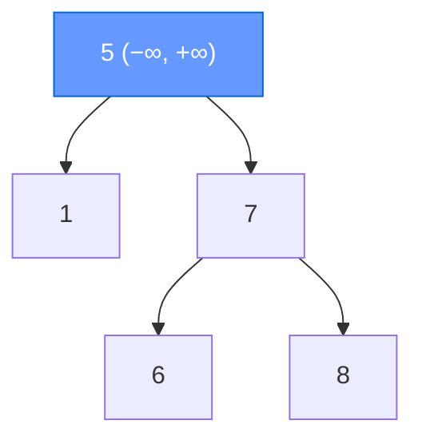
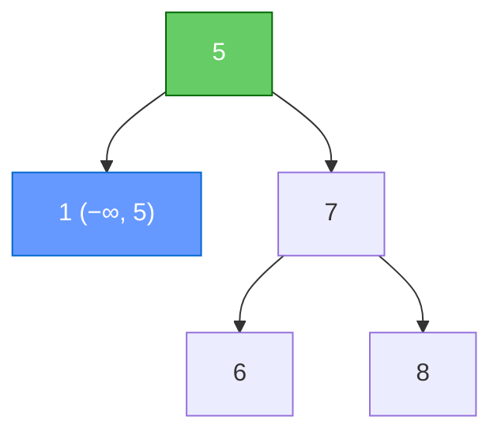
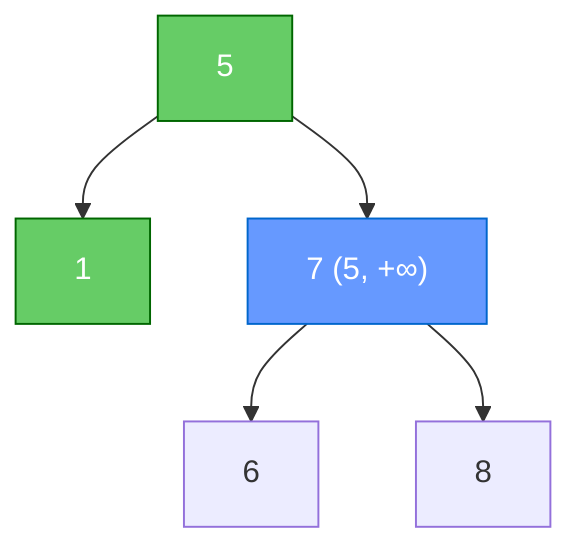
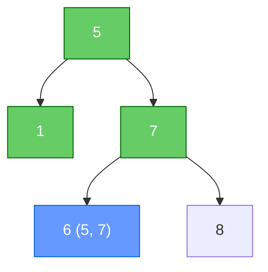
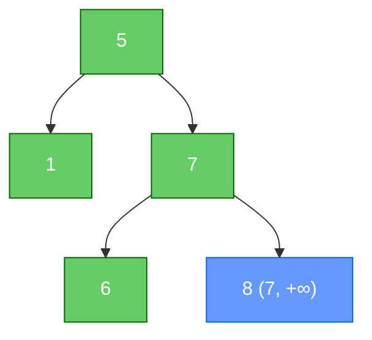

# Задача 2. Validate BST

## Контракт

Функция `is_valid_bst(root) -> bool` принимает корень произвольного
бинарного дерева (`TreeNode | None`) и возвращает `True`, если дерево
является корректным BST (для каждого узла все значения в левом поддереве
строго меньше, в правом — строго больше), иначе `False`.

## Объяснение решения

Наивная проверка «левый < узел < правый» **недостаточна**: нарушение
может быть глубоко в поддереве относительно предка.

Правильный инвариант: каждый узел лежит в открытом интервале `(low, high)`.
При спуске интервал сужается:

- влево: `high := node.val` (всё слева должно быть `< node.val`);
- вправо: `low := node.val` (всё справа должно быть `> node.val`).

Старт: `(-∞, +∞)`. Пустое поддерево — валидно.

**Корректность.** Индукция по дереву: если корень в `(low, high)` и оба
поддерева валидны в суженных интервалах, то все узлы слева `< root.val`
и все справа `> root.val`, значит дерево — BST. Обратно: любой узел BST
лежит в интервале, заданном предками.

Равные значения считаем нарушением (`low < val < high` — строгие границы).

## Оценка сложности

Пусть `n` — число узлов, `h` — высота.

| | Сложность | Почему |
|---|---|---|
| **Время** | `O(n)` | каждый узел проверяется один раз |
| **Память** | `O(h)` | стек рекурсии, худший случай `O(n)` |

## Визуализация работы алгоритма

Нетривиальный пример — дерево, которое *локально* похоже на BST,
но глобально неверно. Синий — текущий узел, зелёный — уже проверен OK,
красный — нарушение.

Исходное дерево:

**Шаг 1.** Узел `5`, интервал `(-∞, +∞)`.  
`−∞ < 5 < +∞` → OK. Дальше: left `(-∞, 5)`, right `(5, +∞)`.

**Шаг 2.** Узел `1`, интервал `(-∞, 5)` (унаследован от предка 5: всё слева `< 5`).  
`−∞ < 1 < 5` → OK. Дети — пустые → валидны.

**Шаг 3.** Узел `4`, интервал `(5, +∞)` (правое поддерево корня: всё должно быть `> 5`).  
`5 < 4 < +∞`? **Нет** (`4 > 5`) → сразу `False`.

Узел `4` — правый ребёнок `5`, обязан быть `> 5`. Локально
`3 < 4 < 6` выглядит нормально, но глобальный инвариант уже сломан —
узлы `3` и `6` даже не проверяем.

---

### Для сравнения — валидное дерево

**Шаг 1.** `5` в `(-∞, +∞)` → OK → left `(-∞, 5)`, right `(5, +∞)`.

**Шаг 2.** `1` в `(-∞, 5)` → OK.

**Шаг 3.** `7` в `(5, +∞)` → OK → left `(5, 7)`, right `(7, +∞)`.

**Шаг 4.** `6` в `(5, 7)`: `5 < 6 < 7` → OK.  
Интервал сузили оба предка: `> 5` (от корня) и `< 7` (от родителя).

**Шаг 5.** `8` в `(7, +∞)`: `7 < 8 < +∞` → OK → **True**.

