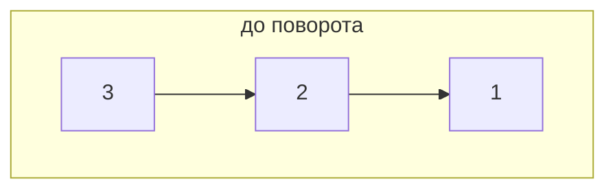
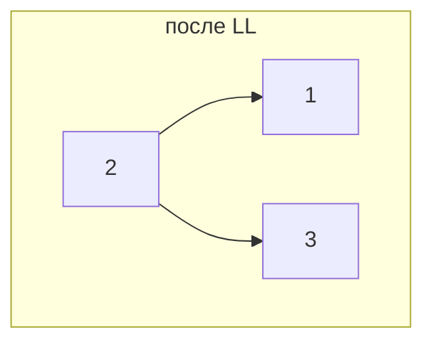
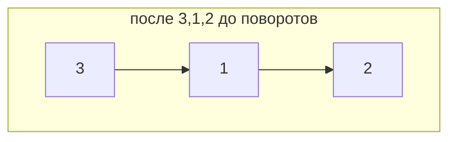
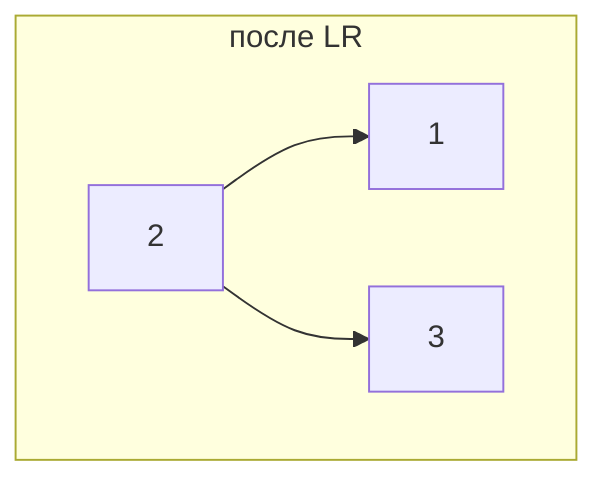
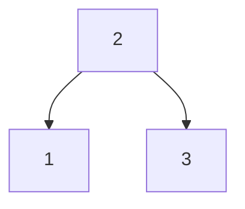
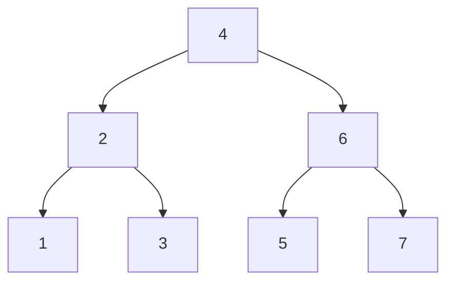

# Задача 3. AVL

## Контракт

Класс `AVL` — самобалансирующееся BST. Операции:

* `insert(key)` — вставка (дубликаты игнорируются);
* `delete(key)` — удаление;
* `search(key) -> bool` — поиск (`key in tree` тоже работает).

Инвариант: у каждого узла `|height(left) − height(right)| ≤ 1`.
Вспомогательно: `inorder()`, `is_balanced()` (для тестов и демонстрации).

## Объяснение решения

Узел хранит `key`, детей и `height`. После каждой вставки/удаления на пути
к корню вызывается `_rebalance`:

| Случай | Условие | Действие |
|--------|---------|----------|
| LL | `bf > 1` и `bf(left) ≥ 0` | правый поворот |
| LR | `bf > 1` и `bf(left) < 0` | левый у left, затем правый |
| RR | `bf < −1` и `bf(right) ≤ 0` | левый поворот |
| RL | `bf < −1` и `bf(right) > 0` | правый у right, затем левый |

Вставка — как в BST, затем подъём с обновлением высот и поворотами.
Удаление — стандартное BST (лист / один ребёнок / преемник), затем
тот же подъём с ребалансировкой.

**Корректность.** Повороты сохраняют inorder-порядок (BST) и локально
восстанавливают `|bf| ≤ 1`. После обработки узла его поддерево снова AVL, высоты актуальны.

## Оценка сложности

Пусть `n` — число ключей. Высота AVL-дерева `h = Θ(log n)`.

| Операция | Время | Память (стек) |
|----------|-------|---------------|
| `search` | `O(log n)` | `O(1)` |
| `insert` | `O(log n)` | `O(log n)` |
| `delete` | `O(log n)` | `O(log n)` |

Память на дерево: `O(n)`.

## Визуализация: вставка и повороты

### LL — вставка `3, 2, 1`

После `3, 2` дерево ещё ок; `1` даёт `bf(3) = 2` → правый поворот вокруг `3`.

### LR — вставка `3, 1, 2`

`bf(3) = 2`, у левого ребёнка `bf(1) = −1` → сначала левый поворот у `1`,
затем правый у `3`. Корень становится `2`.

### RR — вставка `1, 2, 3`

Симметрично LL: левый поворот вокруг `1` → корень `2`.

### RL — вставка `1, 3, 2`

Правый поворот у `3`, затем левый у `1` → корень `2`.

### Удаление с ребалансировкой

Идеальное дерево после `1..7` (корень `4`). Удаляем `1, 2, 3` —
левое поддерево пустеет, на пути вверх срабатывают повороты, инвариант
AVL сохраняется (проверяется `is_balanced()` в тестах).

После удаления `1, 2, 3` inorder = `[4, 5, 6, 7]`, дерево остаётся
с `|bf| ≤ 1` у каждого узла.
