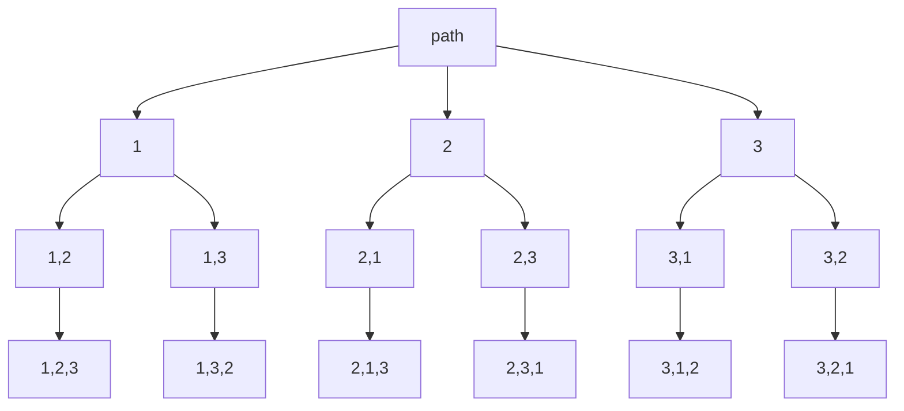

# Задача 2. Permutations

## Контракт

Функция `permute(nums) -> list[list[int]]` возвращает все перестановки
массива. Порядок групп не зафиксирован, в тестах сравнение после сортировки.

Опционально: `permute(nums, trace=True, file=...)` печатает стек вызовов
рекурсивного шага через декоратор `tracer` из `/homework_5/tracer/`.

## Объяснение решения

1. держим текущий путь `path` и маску `used[i]`, взят ли `nums[i]`;
2. если `len(path) == n`, то копируем путь в ответ;
3. иначе пробуем каждый свободный индекс: пометить → положить в путь →
   рекурсия → откат.

Так перебираются все инъективные последовательности индексов длины `n`,
т.е. все перестановки.

**Корректность.** На глубине `k` в пути ровно `k` различных индексов.
База `k = n` даёт полную перестановку. Ветвление по всем ещё не взятым
индексам покрывает `n!` листьев без пропусков и без повторов по индексам.

Визуализация стека: при `trace=True` функция `step` оборачивается
`@tracer`, на каждом уровне видно вход, отступ = глубина, и выход.

## Оценка сложности

Пусть `n = len(nums)`.

| | Сложность | Почему |
|---|---|---|
| **Время** | `O(n · n!)` | `n!` перестановок, каждая копируется за `O(n)` |
| **Память** | `O(n · n!)` на ответ, стек `O(n)` | путь + `used` + глубина рекурсии |

## Визуализация работы алгоритма

`nums = [1, 2, 3]`. Дерево решений (выбор следующего элемента):



Фрагмент трассы при `permute([1, 2], trace=True)`:

```
-> step()
  -> step()
    -> step()
    <- step = None          # зафиксировали [1, 2]
  <- step = None
  -> step()
    -> step()
    <- step = None          # зафиксировали [2, 1]
  <- step = None
<- step = None
```
