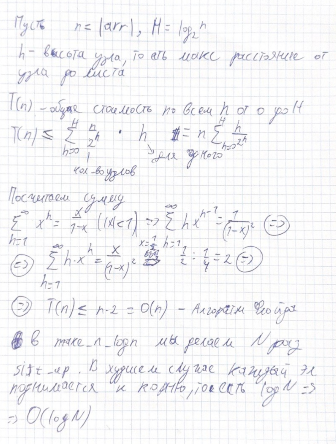

# Задача 1. Makeheap

## Контракт

* makeheap_n_log_n(arr) — строит min-heap за O(N log N) (последовательные
  sift_up). Мутирует arr inplace, возвращает его же.
* makeheap(arr) — строит min-heap за O(N) (алгоритм Флойда,
  bottom-up sift_down). Мутирует arr inplace, возвращает его же.
* is_minheap(arr) — вспомогательная проверка свойства кучи (для тестов).

## Объяснение решения

Массив arr[0..n-1] интерпретируем как полное бинарное дерево:

* родитель i → дети 2i+1, 2i+2;
* свойство min-heap: arr[parent] ≤ arr[child] для всех рёбер.

### makeheap_n_log_n — N вставок

Префикс arr[0..0] уже куча. Для i = 1 .. n-1 «вставляем» arr[i]
в кучу размера i вызовом _sift_up(arr, i): элемент поднимается к корню,
пока меньше родителя. Каждая вставка — не более O(log i) обменов → суммарно
O(N log N).

### makeheap — heapify Флойда

Листья (i ≥ ⌊n/2⌋) уже корректные одноэлементные кучи. Идём
снизу вверх по нелистовым узлам i = ⌊n/2⌋−1 .. 0 и вызываем
_sift_down(arr, i, n): узел опускается, пока не станет ≤ обоих детей.
После обработки корня весь массив, это min-heap.

**Корректность (индукция по высоте).** После sift_down у узла i оба
поддерева уже были кучами, а сам узел просеян на правильное место →
поддерево с корнем i снова куча. Шаг доходит до корня.

## Доказательство сложности makeheap = O(N)

## Визуализация: makeheap_n_log_n на [4, 1, 3, 2, 16, 9, 10, 14, 8, 7]

Префикс `[4]` уже куча. Для `i = 1 .. 9` вызываем `sift_up(i)`.

| i | элемент | действие sift_up | массив |
|---|----------|------------------|--------|
| старт | — | — | `[4, 1, 3, 2, 16, 9, 10, 14, 8, 7]` |
| 1 | 1 | 1 < 4 → вверх к корню | `[1, 4, 3, 2, 16, 9, 10, 14, 8, 7]` |
| 2 | 3 | 3 ≥ 1 — ок | без изменений |
| 3 | 2 | 2 < 4 → вверх; 2 ≥ 1 — стоп | `[1, 2, 3, 4, 16, 9, 10, 14, 8, 7]` |
| 4 | 16 | 16 ≥ 2 — ок | без изменений |
| 5 | 9 | 9 ≥ 3 — ок | без изменений |
| 6 | 10 | 10 ≥ 3 — ок | без изменений |
| 7 | 14 | 14 ≥ 4 — ок | без изменений |
| 8 | 8 | 8 ≥ 4 — ок | без изменений |
| 9 | 7 | 7 < 16 → вверх; 7 ≥ 2 — стоп | `[1, 2, 3, 4, 7, 9, 10, 14, 8, 16]` |

Итог — min-heap: корень `1`.

## Визуализация: makeheap на [4, 1, 3, 2, 16, 9, 10, 14, 8, 7]

n = 10, последний нелист = ⌊10/2⌋−1 = 4.

| i | узел | действие sift_down | массив |
|-----|------|----------------------|--------|
| старт | — | — | [4, 1, 3, 2, 16, 9, 10, 14, 8, 7] |
| 4 | 16 | 16 > 7 → вниз к 7 | [4, 1, 3, 2, 7, 9, 10, 14, 8, 16] |
| 3 | 2 | 2 ≤ 14, 8 — ок | без изменений |
| 2 | 3 | 3 ≤ 9, 10 — ок | без изменений |
| 1 | 1 | 1 ≤ 2, 7 — ок | без изменений |
| 0 | 4 | 4 > 1 → с 1; далее 4 vs 2,7 → с 2; 4 vs 14,8 — ок | [1, 2, 3, 4, 7, 9, 10, 14, 8, 16] |

Итог — min-heap: корень 1, каждый родитель ≤ детей. На этом входе оба метода
дают один и тот же массив (в общем случае форма кучи может отличаться).

## Сравнение времени

На случайных данных средний путь sift_up короткий, поэтому
makeheap_n_log_n часто близок к линейному. Чтобы увидеть разницу
асимптотик, сравниваем на убывающем массиве: каждый sift_up идёт
почти до корня → истинный Θ(N log N), а Floyd остаётся O(N).

Тест test_compare_times_linear_faster_on_large_n, n = 300_000,
минимум из 3 прогонов:

Прогон (n = 300_000, убывающий вход):

| Метод | Асимптотика (худш.) | Время |
|-------|---------------------|-------|
| makeheap | O(N) | 0.0928s |
| makeheap_n_log_n | Θ(N log N) на reverse | 0.5290s (**5.70×** медленнее) |

Конечно это зависит от характеристик компьютера

## Память

Оба метода: **O(1)** дополнительной памяти (inplace + константа на индексы).
Стек рекурсии не используется.
